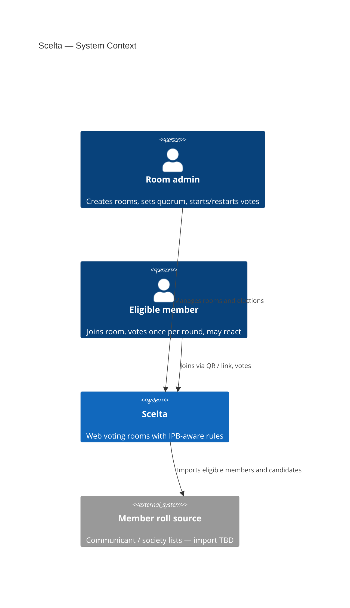
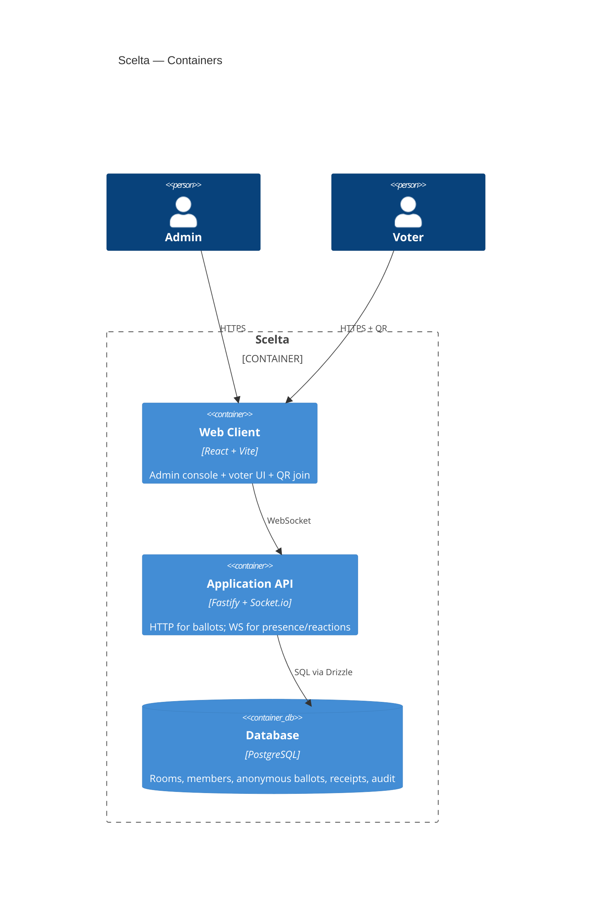
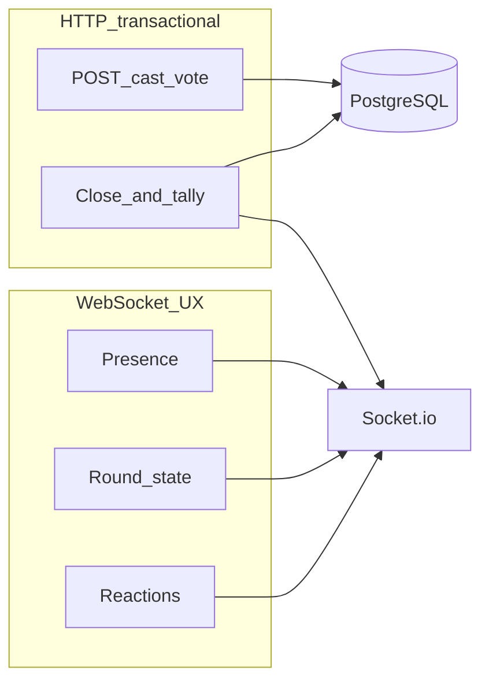
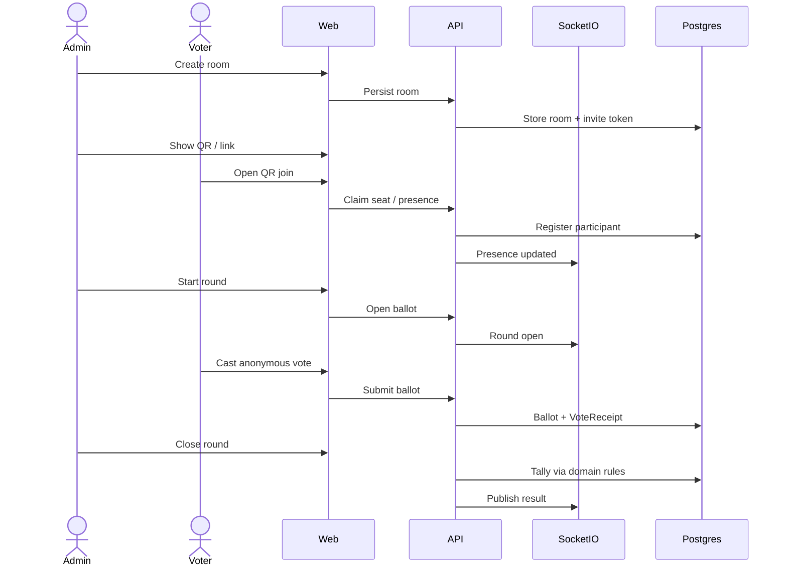

# Architecture

> **Status:** stack decided (Fastify + React + PostgreSQL). Implementation is scaffolding-first.

## Product context

Scelta digitizes church voting rooms: admin-configured quorum and rounds, QR join, anonymous single ballots, automatic tally, candidate lists from member rolls, optional moderated reactions.

## Chosen stack

| Concern | Choice | Why |
| --- | --- | --- |
| Language | TypeScript | Shared types across API, web, and domain |
| API | Fastify + TypeBox | Schema validation on every route; lean Node runtime |
| Realtime UX | Socket.io | Presence, round state, reactions (not ballots) |
| Web | React + Vite | Admin + voter UI; simple Docker/static hosting |
| Domain rules | `@scelta/domain` | Pure functions for quorum/majority/rounds — unit-tested |
| Database | PostgreSQL + Drizzle | ACID tallies; explicit SQL-friendly schema |
| Monorepo | pnpm workspaces | Clear package boundaries |
| Deploy | Docker Compose | Self-hostable for church data control |

## Context (C4 — Level 1)

## Containers (C4 — Level 2)

## Ballot vs realtime

**Invariant:** `ballots` never store `participant_id`. `vote_receipts` store that someone voted, not for whom.

## Core flow

## Decisions log

| Date | Decision | Rationale | Status |
| --- | --- | --- | --- |
| 2026-03-26 | Product = church voting rooms (IPB-first) | Stakeholder description | Accepted |
| 2026-03-26 | Fastify + React + PostgreSQL + Socket.io + Docker | Serious schema-validated API, TS end-to-end, self-host | Accepted |

## Open questions

- Admin auth provider details (session cookies vs OIDC)
- Exact voter identity claim UX at QR join
- Multi-tenant SaaS vs single-church deploy defaults
