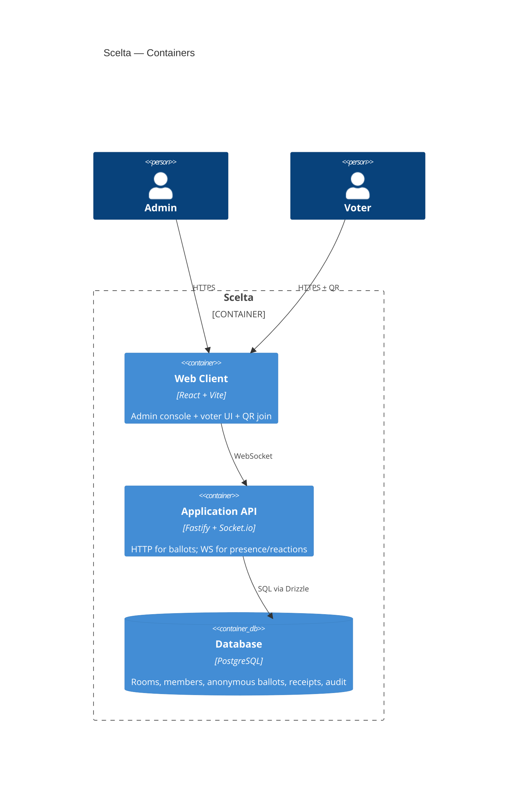
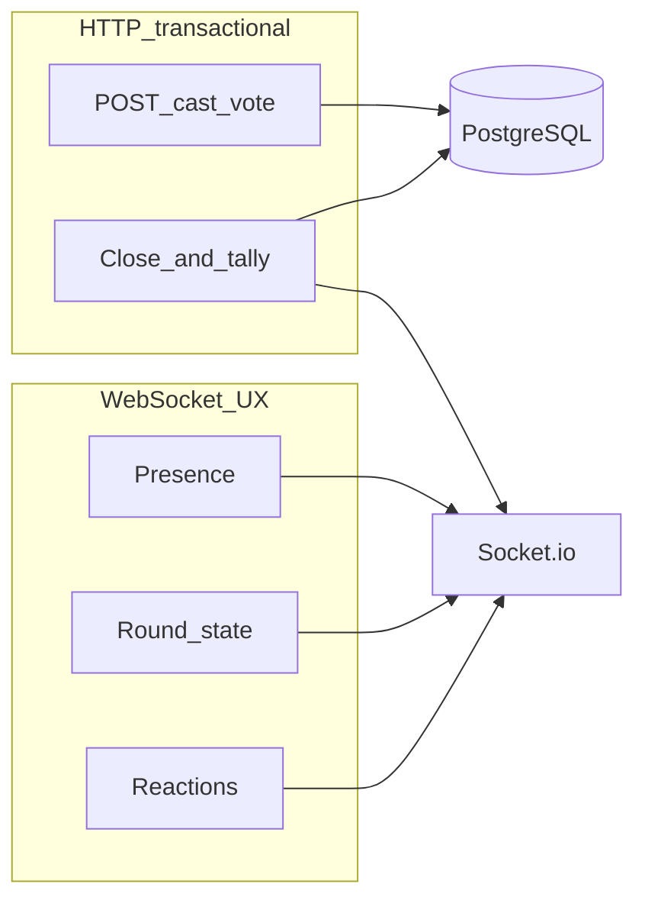
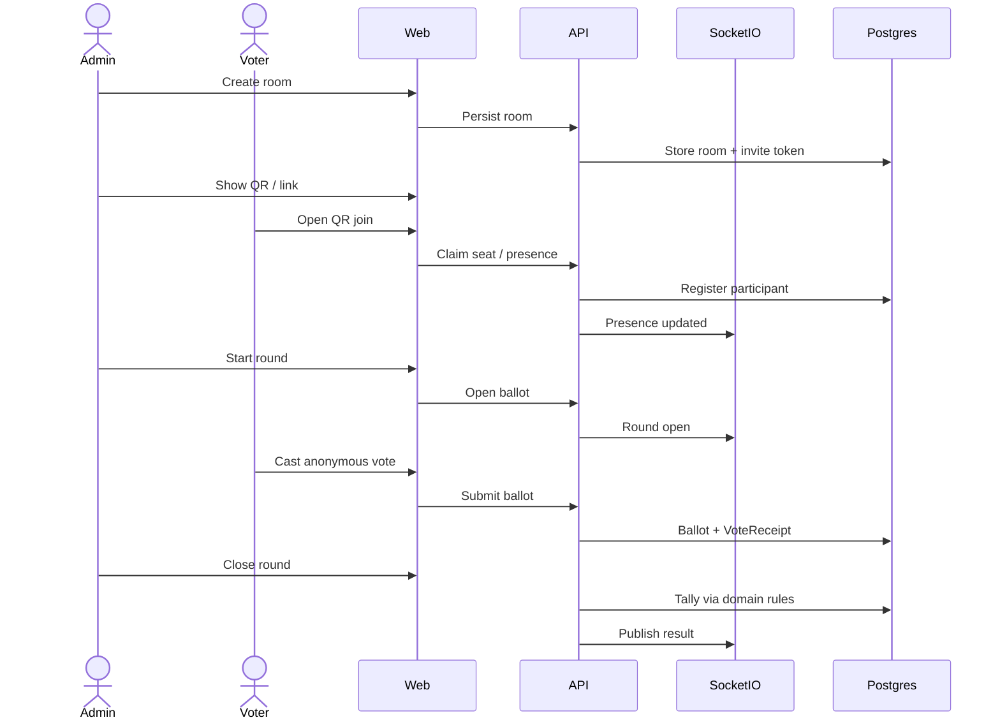

# Architecture

> **Status:** stack decided (Fastify + React + PostgreSQL). Implementation is scaffolding-first.

## Product context

Scelta digitizes church voting rooms: admin-configured quorum and rounds, QR join, anonymous single ballots, automatic tally, candidate lists from member rolls, optional moderated reactions.

## Chosen stack

| Concern | Choice | Why |
| --- | --- | --- |
| Language | TypeScript | Shared types across API, web, and domain |
| API | Fastify + TypeBox | Schema validation on every route; lean Node runtime |
| Realtime UX | Socket.io | Presence, round state, reactions (not ballots) |
| Web | React + Vite | Admin + voter UI; simple Docker/static hosting |
| Domain rules | `@scelta/domain` | Pure functions for quorum/majority/rounds — unit-tested |
| Database | PostgreSQL + Drizzle | ACID tallies; explicit SQL-friendly schema |
| Monorepo | pnpm workspaces | Clear package boundaries |
| Deploy | Docker Compose | Self-hostable for church data control |

## Context (C4 — Level 1)

## Containers (C4 — Level 2)

## Ballot vs realtime

**Invariant:** `ballots` never store `participant_id`. `vote_receipts` store that someone voted, not for whom.

## Core flow

## Decisions log

| Date | Decision | Rationale | Status |
| --- | --- | --- | --- |
| 2026-03-26 | Product = church voting rooms (IPB-first) | Stakeholder description | Accepted |
| 2026-03-26 | Fastify + React + PostgreSQL + Socket.io + Docker | Serious schema-validated API, TS end-to-end, self-host | Accepted |
| 2026-11-12 | Admin routes use a server-side bearer token (`ADMIN_TOKEN`) until an auth provider is chosen | Fail closed on room create/list; voters do not receive this token | Superseded |
| 2026-11-12 | Admin access is a user role (`admin` or `member`) with an httpOnly session cookie. Invite and ballot routes stay anonymous | A shared bearer token cannot tell admins from members, and a login must not be required to cast an anonymous vote. Passwords are scrypt hashes. OIDC can replace the password check later without changing the role model | Accepted |
| 2026-11-13 | QR join identity is a display name plus a client join key. The server stores the SHA-256 only. Draft, closed, and cancelled rooms reject the invite; open and voting accept it. Presence is pushed on Socket.io and polled by the admin | Member import does not exist yet, and the same browser must not count twice toward quorum | Accepted |
| 2026-11-13 | Closing a round below the required presence records `failed_quorum` and does not elect a winner. Publish is rejected until a closed round outcome is `elected`. Percent quorum with `eligible_count` 0 cannot be met. Absolute quorum uses `quorum_value` only | A silent winner below quorum would mis-state the assembly. An empty eligible list must not look like a met percent | Accepted |
| 2026-11-13 | Casting a ballot inserts a `vote_receipts` row (`round_id`, `participant_id`) and an anonymous `ballots` row (`round_id`, `candidate_id`, random `ballot_token`) in a single database transaction. Closing a round that meets quorum automatically tallies ballots against eligible candidates and sets outcome `elected` (> 50%) or `no_majority` | Enforces one-vote-per-round via `vote_receipts` unique index while keeping `ballots` unlinkable to participants | Accepted |
| 2026-11-13 | Opening a round after `no_majority` resolves the next round's eligible candidate subset via `resolveNextRoundCandidateIds` (`nextRoundPlan` or admin subset) and marks eliminated candidates `is_eligible = false` inside the round-opening transaction; opening after `elected` is rejected | Ensures 3rd-round runoffs (top-2 for `ipb_society_board`, most-voted or admin subset for `ipb_local_officers`) enforce candidate eligibility at the DB and API boundaries while resetting per-round ballots and receipts | Accepted |
| 2026-11-13 | Restarting an open round (`POST /v1/admin/rooms/:roomId/rounds/:roundId/restart`) deletes `ballots` and `vote_receipts` for that `round_id` and records an `audit_events` row (`action = 'round_restarted'`) in a single transaction, incrementing `restartCount` and emitting round lifecycle events (`open`, `closed`, `restarted`) | Allows the assembly chair to restart a flawed ballot with a tamper-evident audit trail while notifying participants to cast a fresh anonymous vote | Accepted |
| 2026-11-13 | Member roll import (`POST /v1/admin/members/import`) parses CSV rows in `@scelta/domain` (`parseMemberImportCsv`), transactionally upserts valid rows into `members` by case-insensitive `full_name` per church, and returns `{ createdCount, updatedCount, rejectedCount, rejectedRows }` | Stores communicant status, gender, birth date, and UPA society flags for candidate suggestion filters while isolating malformed CSV lines with explicit rejection reasons | Accepted |
| 2026-11-13 | Candidate suggestions (`GET /v1/admin/members/suggestions`) filter the church member roll in `@scelta/domain` (`suggestCandidates`, `isMemberEligibleForRoomType`) by `roomType` (CI/IPB communicant men >= 18 for `elder`/`deacon`/`pastor`; active UPA + >= 6 months seniority for `upa_board`; communicant for `custom`, with configurable thresholds) and `POST /v1/admin/rooms` rejects candidates who match an ineligible member on the roll | Prevents ineligible members from appearing as selectable suggestions or being added to a room ballot when a member roll is present | Accepted |

## Open questions

- Whether a later OIDC provider replaces the email/password check
- Multi-tenant SaaS vs single-church deploy defaults
- When invite links should expire by time (today a missing token is invalid, and closing the room is what shuts the door)
