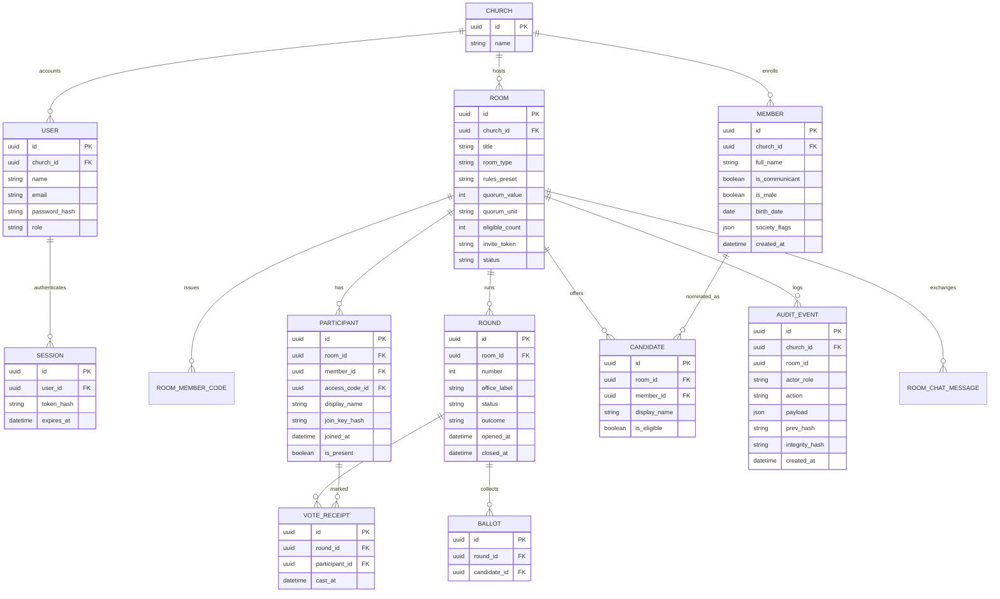

# Data model

> PostgreSQL / Drizzle ORM data model for Scelta (`@scelta/db`).  
> **Anonymity invariant:** a `Ballot` must never be joinable to a `Participant` or a `VoteReceipt` in any way that reveals a voter's choice.

## Domain overview



## Entities

### Church

Tenant / congregation using Scelta. `name` is unique: one row per church name, so concurrent room creation cannot split the admin list.

### User

Login account for the console. This is not the member roll and is never stored on a ballot.

| Field | Notes |
| --- | --- |
| `email` | Unique, stored lowercase |
| `password_hash` | scrypt hash. The raw password is never stored or returned |
| `role` | `admin` manages rooms. `member` can sign in and still cannot open the admin console. Self-registration always creates `member` |

### Session

Server-side login session. The cookie holds a random token; the database stores only its hash. Logout deletes the row. Expired rows are rejected.

### Member

Person on a church (or society) roll. Used for eligibility and candidate suggestions. Not the same as a `User`.

| Field | Notes |
| --- | --- |
| `is_communicant` | Required for local assembly voting (CI/IPB art. 112) |
| `is_male` / age | Relevant for elder/deacon candidacy (art. 25 §2) |
| `society_flags` | e.g. UPA/UMP active, membership start date for seniority rules |

### Room

A single election session created by an admin (QR join target).

| Field | Notes |
| --- | --- |
| `room_type` | `pastor`, `elder`, `deacon`, `session_board`, `upa_board`, `ump_board`, or `custom` |
| `rules_preset` | `ipb_local_officers`, `ipb_society_board`, or `custom`. Majority and round behavior are derived from the preset, not stored as separate columns |
| `quorum_value` + `quorum_unit` | Absolute count (`>= 1`), or percent (`1–100`) of `eligible_count` |
| `eligible_count` | Denominator for a percent quorum. Stays 0 until the admin sets it. Absolute quorum ignores it. A percent quorum with 0 cannot be met |
| `invite_token` | Unguessable, unique capability behind the QR / short link (`/join/{token}`) |
| `status` | `draft` · `open` · `test` · `closed`. A closed room cannot be reopened, and status or quorum cannot be changed while a round is `open` |

### Participant

Person present in the room. Tracks **presence**, not ballot content.

| Field | Notes |
| --- | --- |
| `display_name` | Member or simulated voter display name |
| `join_key_hash` | SHA-256 of the client join key. Unique together with `room_id` |
| `is_present` | Counts toward quorum while true. Removing a participant who already voted sets `is_present = false` without invalidating their cast ballot |

### Round

One ballot open period (1st, 2nd, 3rd/runoff). Society and Session board rooms (`upa_board`, `ump_board`, `session_board`) run **office-by-office** (`office_label`), with per-office round numbering for majority and runoff rules.

- `status`: `pending` · `open` · `closed` · `restarted`. At most one round per room can have `status = 'open'` (enforced by partial unique index `rounds_one_open_uidx`).
- `outcome`: `null` while open, or one of `'failed_quorum'`, `'no_majority'`, `'elected'`, `'declined'`, `'annulled'` (enforced by `rounds_outcome_check`).
- Restarting an open round marks it `status = 'restarted'` and `outcome = 'annulled'`, preserves its cast ballots and receipts, logs the annulled totals in `audit_events`, and opens a new round with `number = max(number) + 1`. Annulled rounds are ignored when counting the 3-round office limit.

### Candidate

Someone selectable on the ballot for this room/round (from member roll + filters, or admin override).

### Ballot & Secrecy Guarantee (`T0.5`)

`ballots` stores **only** `(id, round_id, candidate_id)`:

- **No `participant_id` foreign key**: there is no relational link to `participants` or `vote_receipts`.
- **No `created_at` timestamp and no `ballot_token`**: previously, `ballots.created_at` and `vote_receipts.cast_at` shared the transaction `now()`, allowing anyone with database read access to correlate a ballot row with a receipt row by timestamp. Removing `created_at` and `ballot_token` from `ballots` makes timestamp/token correlation mathematically impossible.
- **No session or receipt fingerprints in `ballot_cast` audit events**: `audit_events` records that a verified voter cast a ballot in the round without `sessionFingerprint` or `receiptFingerprint`.

### VoteReceipt

Proves a participant already voted in that round (`unique(round_id, participant_id)`) without revealing the choice.

### AuditEvent (`T0.8`)

Append-only, cryptographically chained log of room and voting events:

- Every insert computes `integrity_hash = SHA-256(prev_hash : id : room_id : actor_role : action : canonical_payload : created_at_iso)[0..16]` referencing the previous event's `integrity_hash` in that room (or `"GENESIS"` for the first event).
- A PostgreSQL trigger (`audit_events_immutable_trg` calling `prevent_audit_events_mutation()`) blocks `UPDATE` and `DELETE` on `audit_events`.
- `audit_events.room_id` intentionally has no foreign key to `rooms` so audit history survives room deletion.
- `GET /v1/admin/rooms/:roomId/audit/verify` recalculates the SHA-256 chain from `"GENESIS"` and reports `chainValid`.

## Versioned Database Migrations (`T0.1`)

Schema changes are managed via versioned Drizzle migrations in `packages/db/drizzle/` and applied automatically on API startup and in PGlite tests via `runMigrations(db)` (`packages/db/src/migrate.ts`).

### How to create and run a migration

1. Edit the schema in `packages/db/src/schema.ts`.
2. Generate a new SQL migration from the repository root:
   ```bash
   pnpm --filter @scelta/db generate
   ```
3. Inspect the generated `.sql` file under `packages/db/drizzle/` (and `packages/db/drizzle/meta/_journal.json`). If adding custom PostgreSQL triggers, functions, or backfill statements, include them in the migration file separated by `--> statement-breakpoint`.
4. Build `@scelta/db` and run the test suite to verify the migration against PGlite:
   ```bash
   pnpm --filter @scelta/db build
   pnpm --filter @scelta/api test:feature
   ```
5. Against a running PostgreSQL database (`DATABASE_URL`), migrations run automatically on API startup (`createPostgresDatabase(url).ensureSchema()` / `runMigrations(db)`), or can be applied manually via:
   ```bash
   pnpm --filter @scelta/db migrate
   ```
