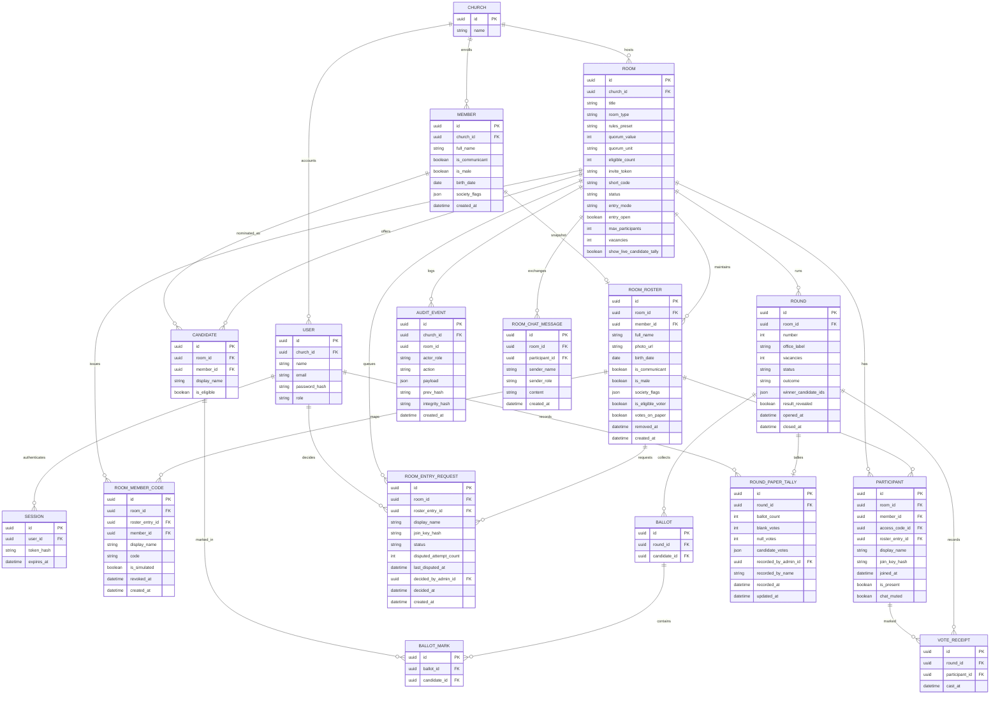

# Data model

> PostgreSQL / Drizzle ORM data model for Scelta (`@scelta/db`).  
> **Anonymity invariant:** a `Ballot` must never be joinable to a `Participant` or a `VoteReceipt` in any way that reveals a voter's choice.

## Domain overview



## Entities

### Church

Tenant / congregation using Scelta. `name` is unique: one row per church name, so concurrent room creation cannot split the admin list.

### User

Login account for the console. This is not the member roll and is never stored on a ballot.

| Field | Notes |
| --- | --- |
| `email` | Unique, stored lowercase |
| `password_hash` | scrypt hash. The raw password is never stored or returned |
| `role` | `admin` manages rooms. `member` can sign in and still cannot open the admin console. Self-registration always creates `member` |

### Session

Server-side login session. The cookie holds a random token; the database stores only its hash. Logout deletes the row. Expired rows are rejected.

### Member

Person on a church (or society) roll. Used for eligibility and candidate suggestions. Not the same as a `User`.

| Field | Notes |
| --- | --- |
| `is_communicant` | Required for local assembly voting (CI/IPB art. 112) |
| `is_male` / age | Relevant for elder/deacon candidacy (art. 25 §2) |
| `society_flags` | e.g. UPA/UMP active, membership start date for seniority rules |

### Room

A single election session created by an admin (QR join target).

| Field | Notes |
| --- | --- |
| `room_type` | `pastor`, `elder`, `deacon`, `session_board`, `upa_board`, `ump_board`, or `custom` |
| `rules_preset` | `ipb_local_officers`, `ipb_society_board`, or `custom`. Majority and round behavior are derived from the preset, not stored as separate columns |
| `quorum_value` + `quorum_unit` | Absolute count (`>= 1`), or percent (`1–100`) of `eligible_count` |
| `eligible_count` | Denominator for a percent quorum. Derived from active room roster size (`room_roster`). Absolute quorum ignores it. A percent quorum with 0 cannot be met |
| `invite_token` | Unguessable, unique capability behind the QR / short link (`/join/{token}`). Rotatable |
| `short_code` | 6-character unambiguous human-readable code for quick joining (`/s/{short_code}`) |
| `status` | `draft` · `open` · `test` · `closed`. A closed room cannot be reopened, and status or quorum cannot be changed while a round is `open` |
| `entry_mode` | `codigo` (traditional access code cards) or `aprovacao` (voter searches roster and requests desk approval) |
| `entry_open` | `boolean` flag. Controls whether new entry requests / joins are accepted. Table admin can pause and reopen entry |
| `max_participants` | Optional presence cap (`int nullable`). Defaults to roster `eligible_count` when null |
| `vacancies` | Number of vacancies to fill in the room (`int not null default 1`, `>= 1`). Relevant for elder and deacon officer elections (`T5.1`); single-office and society board rooms default to 1 |
| `show_live_candidate_tally` | `boolean not null default false`. When enabled by table admin (`T6.3`), projector/telão displays live candidate-by-candidate vote standings during open scrutiny |

### RoomRoster (`T2.1`)

The room's snapshot roll of eligible voters (`room_roster`). Independent from general church member list edits once populated.

| Field | Notes |
| --- | --- |
| `room_id` | Foreign key to `rooms.id` (cascades on delete) |
| `member_id` | Optional foreign key to `members.id`. Null for ad-hoc / visitor entries added directly to the room |
| `full_name` | Name on the voter roll |
| `birth_date` | Used for voter birth date verification (day/month) in approval entry mode |
| `is_communicant` | Required for local assembly voting (CI/IPB art. 112) |
| `is_male` / age | Relevant for elder/deacon candidacy (art. 25 §2) |
| `society_flags` | e.g. UPA/UMP active, membership start date for seniority rules |
| `is_eligible_voter` | Whether this person counts towards quorum and can vote |
| `votes_on_paper` | Marked when voter casts ballots physically on paper (`T3.1`). Revokes online code/session |
| `removed_at` | Soft removal timestamp. Excludes from active roster while preserving vote audit history |

**Constraints & Indexes:**
- Partial unique index `room_roster_active_member_uidx` on `(room_id, member_id) WHERE removed_at IS NULL AND member_id IS NOT NULL`.

### RoomMemberCode (`T1.2`, `T1.4`)

Access codes issued for card-based entry (`room_member_codes`). Used when `entry_mode = 'codigo'`.

| Field | Notes |
| --- | --- |
| `room_id` | Foreign key to `rooms.id` |
| `roster_entry_id` | Optional foreign key to `room_roster.id` |
| `member_id` | Optional foreign key to `members.id` |
| `display_name` | Printed voter display name |
| `code` | Unique access code within room |
| `revoked_at` | Revocation timestamp when paper mode is enabled or roster entry removed |

### Participant

Person present in the room. Tracks **presence**, not ballot content.

| Field | Notes |
| --- | --- |
| `display_name` | Member or simulated voter display name |
| `access_code_id` | Optional FK to `room_member_codes.id` when entering via code card |
| `roster_entry_id` | Optional FK to `room_roster.id`. Enforces at most one active participant per roster entry |
| `join_key_hash` | SHA-256 of the client join key, or null when released by an admin (`T1.5`). Unique together with `room_id` |
| `is_present` | Counts toward quorum while true. Removing a participant who already voted sets `is_present = false` without invalidating their cast ballot |
| `chatMuted` | Participant-specific chat moderation flag |

**Constraints & Indexes:**
- Partial unique index `participants_room_access_code_uidx` on `(room_id, access_code_id) WHERE access_code_id IS NOT NULL`.
- Partial unique index `participants_room_roster_entry_uidx` on `(room_id, roster_entry_id) WHERE roster_entry_id IS NOT NULL`.
- Unique index `participants_room_join_key_uidx` on `(room_id, join_key_hash)`.

### RoomEntryRequest (`T4.2`, `T4.3`)

In approval entry mode (`entry_mode = 'aprovacao'`), voters search their name on the room roster and request entry (`room_entry_requests`).

| Field | Notes |
| --- | --- |
| `id` | Primary key |
| `room_id` | Foreign key to `rooms.id` (cascades on delete) |
| `roster_entry_id` | Foreign key to `room_roster.id` (cascades on delete) |
| `display_name` | Voter display name from roster entry |
| `join_key_hash` | Client-generated join key hash for authenticating the voter session |
| `status` | `pending` · `approved` · `rejected` · `cancelled` |
| `disputed_attempt_count` | Number of duplicate/disputed entry attempts on this name |
| `last_disputed_at` | Timestamp of the most recent disputed attempt |
| `decided_by_admin_id` | Admin `users.id` who approved or rejected the request |
| `decided_at` | Timestamp when the decision was made |
| `created_at` | Timestamp when request was submitted |

**Constraints & Indexes:**
- Partial unique index `room_entry_requests_pending_roster_uidx` on `(room_id, roster_entry_id) WHERE status = 'pending'` guarantees at most one pending request per roster entry.
- Index `room_entry_requests_room_status_idx` on `(room_id, status)` for queue retrieval.
- Index `room_entry_requests_room_join_key_idx` on `(room_id, join_key_hash)` for client status polling.

### Round

One ballot open period (1st, 2nd, 3rd/runoff). Society and Session board rooms (`upa_board`, `ump_board`, `session_board`) run **office-by-office** (`office_label`), with per-office round numbering for majority and runoff rules.

- `vacancies`: integer `>= 1` (default 1). Number of open seats for this specific ballot round. In multi-vacancy officer elections, subsequent rounds decrement `vacancies` by the number of officers already elected.
- `winner_candidate_ids`: JSON array of UUID strings (`jsonb not null default '[]'`). Records all candidate IDs elected in this round when one or more candidates attain absolute majority (> 50% of cast ballots).
- `result_revealed`: `boolean not null default false`. Controls when closed round outcome and winners are projected on the telão screen (`T6.2`); revealed only after table admin explicitly triggers "Revelar Resultado".
- `status`: `pending` · `open` · `closed` · `restarted`. At most one round per room can have `status = 'open'` (enforced by partial unique index `rounds_one_open_uidx`).
- `outcome`: `null` while open, or one of `'failed_quorum'`, `'no_majority'`, `'elected'`, `'declined'`, `'annulled'` (enforced by `rounds_outcome_check`).
- Restarting an open round marks it `status = 'restarted'` and `outcome = 'annulled'`, preserves its cast ballots and receipts, logs the annulled totals in `audit_events`, and opens a new round with `number = max(number) + 1`. Annulled rounds are ignored when counting the 3-round office limit.

### RoundPaperTally (`T3.2`)

Stores physical paper ballot counts for a round when some voters use paper ballots (`round_paper_tallies`).

| Field | Notes |
| --- | --- |
| `round_id` | Foreign key to `rounds.id` (unique index `round_paper_tallies_round_uidx`, cascades on delete) |
| `ballot_count` | Total physical ballots collected from the urn |
| `blank_votes` | Physical blank votes |
| `null_votes` | Physical null / spoiled votes |
| `candidate_votes` | JSON map of candidate UUID to paper vote count (`Record<string, number>`) |
| `recorded_by_admin_id` | Admin `users.id` who recorded or updated the paper tally |
| `recorded_by_name` | Admin display name snapshot |
| `recorded_at` / `updated_at` | Audit timestamps |

### Candidate

Someone selectable on the ballot for this room/round (from member roll + filters, or admin override).

### BallotMark (`T5.2`)

Links an anonymous ballot to up to N marked candidates when `round.vacancies >= 1` (`ballot_marks`). For blank ballots or single-vacancy rounds, `ballots.candidate_id` is maintained for backward compatibility; multi-mark ballots store one row per selected candidate in `ballot_marks`.

| Field | Notes |
| --- | --- |
| `id` | Primary key UUID |
| `ballot_id` | Foreign key to `ballots.id` (cascades on delete) |
| `candidate_id` | Foreign key to `candidates.id` (cascades on delete) |

**Constraints & Indexes:**
- Unique index `ballot_marks_ballot_candidate_uidx` on `(ballot_id, candidate_id)` prevents selecting the same candidate more than once on a single ballot.
- Index `ballot_marks_ballot_idx` on `(ballot_id)` for efficient mark queries.

### Ballot & Secrecy Guarantee (`T0.5`, `T5.2`)

`ballots` stores **only** `(id, round_id, candidate_id)`, and `ballot_marks` stores **only** `(id, ballot_id, candidate_id)`:

- **No voter reference**: there is no relational link to `participants`, `room_entry_requests`, `room_roster`, `room_member_codes`, or `vote_receipts`.
- **Multi-mark ballot anonymity**: `ballot_marks` holds 0..N marks per ballot without `participant_id`, timestamp, or token. Marks are queried with deterministic ordering (by candidate ID or name), ensuring physical insertion order is never preserved or exposed.
- **Physical ballot segregation**: `round_paper_tallies` stores only aggregated vote counts for the round, keeping physical and electronic ballots separated from voter identities.
- **No `created_at` timestamp and no `ballot_token`**: previously, `ballots.created_at` and `vote_receipts.cast_at` shared the transaction `now()`, allowing anyone with database read access to correlate a ballot row with a receipt row by timestamp. Removing `created_at` and `ballot_token` from `ballots` makes timestamp/token correlation mathematically impossible.
- **No session or receipt fingerprints in `ballot_cast` audit events**: `audit_events` records that a verified voter cast a ballot in the round without `sessionFingerprint` or `receiptFingerprint`.

### VoteReceipt

Proves a participant already voted in that round (`unique(round_id, participant_id)`) without revealing the choice.

### AuditEvent (`T0.8`)

Append-only, cryptographically chained log of room and voting events:

- Every insert computes `integrity_hash = SHA-256(prev_hash : id : room_id : actor_role : action : canonical_payload : created_at_iso)[0..16]` referencing the previous event's `integrity_hash` in that room (or `"GENESIS"` for the first event).
- A PostgreSQL trigger (`audit_events_immutable_trg` calling `prevent_audit_events_mutation()`) blocks `UPDATE` and `DELETE` on `audit_events`.
- `audit_events.room_id` intentionally has no foreign key to `rooms` so audit history survives room deletion.
- `GET /v1/admin/rooms/:roomId/audit/verify` recalculates the SHA-256 chain from `"GENESIS"` and reports `chainValid`.

## Versioned Database Migrations (`T0.1`)

Schema changes are managed via versioned Drizzle migrations in `packages/db/drizzle/` and applied automatically on API startup and in PGlite tests via `runMigrations(db)` (`packages/db/src/migrate.ts`).

### How to create and run a migration

1. Edit the schema in `packages/db/src/schema.ts`.
2. Generate a new SQL migration from the repository root:
   ```bash
   pnpm --filter @scelta/db generate
   ```
3. Inspect the generated `.sql` file under `packages/db/drizzle/` (and `packages/db/drizzle/meta/_journal.json`). If adding custom PostgreSQL triggers, functions, or backfill statements, include them in the migration file separated by `--> statement-breakpoint`.
4. Build `@scelta/db` and run the test suite to verify the migration against PGlite:
   ```bash
   pnpm --filter @scelta/db build
   pnpm --filter @scelta/api test:feature
   ```
5. Against a running PostgreSQL database (`DATABASE_URL`), migrations run automatically on API startup (`createPostgresDatabase(url).ensureSchema()` / `runMigrations(db)`), or can be applied manually via:
   ```bash
   pnpm --filter @scelta/db migrate
   ```
