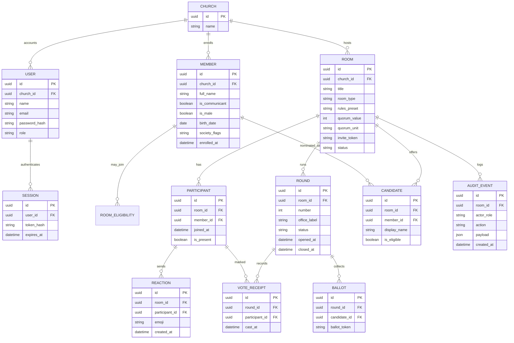

# Data model

> Draft domain model for Scelta. Technology (SQL/NoSQL, IDs) TBD.  
> **Anonymity invariant:** a `Ballot` must not be joinable to a `Participant` in a way that reveals the chosen option.

## Domain overview

## Entities

### Church

Tenant / congregation using Scelta. `name` is unique: one row per church name, so concurrent room creation cannot split the admin list.

### User

Login account for the console. This is not the member roll and is never stored on a ballot.

| Field | Notes |
| --- | --- |
| `email` | Unique, stored lowercase |
| `password_hash` | scrypt hash. The raw password is never stored or returned |
| `role` | `admin` manages rooms. `member` can sign in and still cannot open the admin console. Self-registration always creates `member` |

### Session

Server-side login session. The cookie holds a random token; the database stores only its hash. Logout deletes the row. Expired rows are rejected.

### Member

Person on a church (or society) roll. Used for eligibility and candidate suggestions. Not the same as a `User`.

| Field | Notes |
| --- | --- |
| `is_communicant` | Required for local assembly voting (CI/IPB art. 112) |
| `is_male` / age | Relevant for elder/deacon candidacy (art. 25 §2) |
| `society_flags` | e.g. UPA active, membership start date for 6-month rule |

### Room

A single election session created by an admin (QR join target).

| Field | Notes |
| --- | --- |
| `room_type` | `pastor`, `elder`, `deacon`, `upa_board`, or `custom` |
| `rules_preset` | `ipb_local_officers`, `ipb_society_board`, or `custom`. Majority and round behavior are derived from the preset, not stored as separate columns |
| `quorum_value` + `quorum_unit` | Absolute count or percent of eligible list |
| `invite_token` | Unguessable, unique capability behind the QR / short link (`/join/{token}`) |
| `status` | `draft` · `open` · `voting` · `closed` · `cancelled` |

### Participant

Member who joined the room. Tracks **presence**, not ballot content.

### Round

One ballot open period (1st, 2nd, 3rd/runoff). Society elections may also be **office-by-office** (`office_label`).

### Candidate

Someone selectable on the ballot for this room/round (from member roll + filters, or admin override).

### Ballot

Anonymous vote record: stores **choice** (+ round) without `participant_id`.

### VoteReceipt

Proves the participant already voted in that round (prevents double voting) without revealing the choice.

### Reaction

Moderated emoji / light interaction; must not encode ballot preference.

### AuditEvent

Admin actions: create room, change quorum, start/restart round, force close, etc.

## Critical invariants

1. **Unlinkability:** no foreign key from `Ballot` → `Participant` (or equivalent cryptographic unlinkability).
2. **Uniqueness:** at most one `VoteReceipt` per `(participant, round)`.
3. **Quorum gate:** published results require presence count ≥ configured quorum at the agreed checkpoint.
4. **Eligibility:** only eligible participants may receive a receipt; only eligible candidates appear on the ballot for that room type.
5. **Restart:** clearing ballots/receipts for a round must write an `AuditEvent`.

## Open questions

- Soft delete vs hard delete for members and rooms
- How blank / null ballots are stored and whether they enter the majority denominator
- Multi-vacancy elections (N winners) vs single office-by-office
- Reaction rate limits and moderation roles
